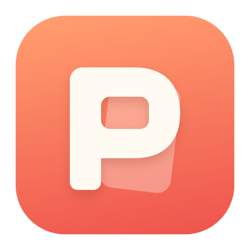
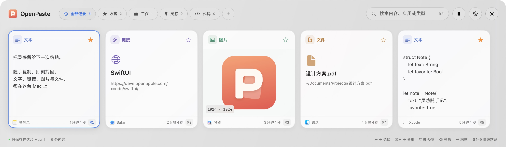
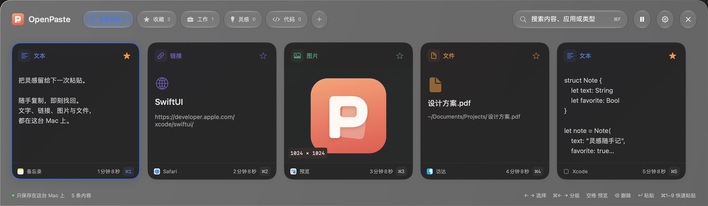
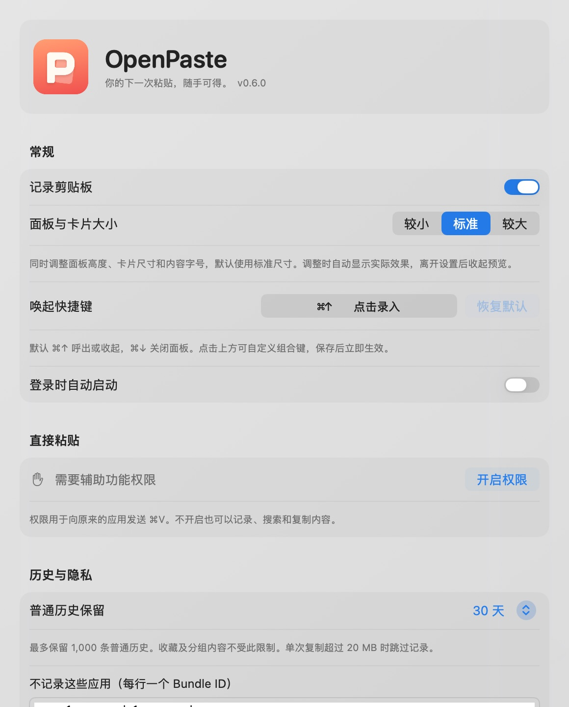

<p align="center">
  
</p>

<h1 align="center">OpenPaste</h1>

<p align="center">你的下一次粘贴，随手可得。</p>
<p align="center">原生、离线的 macOS 剪贴板管理工具。用快捷键找回文字、链接、图片和文件。</p>

<p align="center">
  <a href="#快速开始">快速开始</a> ·
  <a href="docs/USAGE.md">使用指南</a> ·
  <a href="CHANGELOG.md">更新记录</a> ·
  <a href="CONTRIBUTING.md">参与贡献</a>
</p>

<p align="center"><strong>macOS 13+</strong> · SwiftUI + AppKit · SQLite · 无第三方依赖 · <a href="LICENSE">MIT</a></p>

## 效果图

屏幕底部的卡片面板，按 **⌘↑** 随时唤起。



<details>
<summary>查看深色界面</summary>



</details>

<details>
<summary>查看设置界面</summary>

<p align="center">
  
</p>

</details>

*界面截图使用示例数据。macOS 26+ 使用 Liquid Glass，较旧系统回退至系统材质。*

## 功能

- **复制即记录** — 保存文本、链接、图片和文件引用，保留受支持的原始格式。
- **快速找回** — 按内容、来源应用和类型搜索，空格预览，回车粘贴。
- **收藏与分组** — 星标常用内容，拖拽卡片归类，自定义分组图标。
- **键盘优先** — 自定义全局快捷键，方向键导航，⌘1–9 快速粘贴，支持纯文本粘贴。
- **本机存储** — 无账号、遥测或云同步；支持暂停记录、应用排除和历史自动清理。
- **按需运行** — 后台不加载历史列表，界面与捕获任务结束后退出；面板支持三档大小。

## 快速开始

构建需要 **Swift 6.2+、macOS 26+ SDK**（Xcode 26+ 或对应 Command Line Tools）。

```sh
git clone https://github.com/Junp0/iPaste.git OpenPaste
cd OpenPaste
./scripts/build.sh
./scripts/run.sh
```

应用生成于 `build/OpenPaste.app`，启动后驻留菜单栏。复制一些内容，按 **⌘↑** 打开历史，再按 **回车** 粘贴。

> 自动粘贴需在 **系统设置 → 隐私与安全性 → 辅助功能** 中允许 OpenPaste。未授权时可先复制，再手动按 ⌘V 粘贴。

首次构建会创建并复用本机签名身份。构建、安装位置与授权说明见[开发指南](docs/DEVELOPMENT.md)。当前版本 **0.6.0**，仍在早期开发；部署目标为 macOS 13+，已在 Apple Silicon 验证，旧系统及 Intel 兼容性待验证。

## 常用快捷键

| 操作 | 默认快捷键 |
| --- | --- |
| 打开 / 收起面板 | ⌘↑ |
| 关闭面板 | ⌘↓ / Esc |
| 选择卡片 / 切换分组 | 方向键 / ⌘← → |
| 粘贴 / 纯文本粘贴 | 回车 / ⇧⌘回车 |
| 快速粘贴前九条 | ⌘1–9 |
| 预览 | 空格 |
| 搜索 / 设置 | ⌘F / ⌘, |

更多交互、拖拽操作与搜索语法见[使用指南](docs/USAGE.md)。

## 数据与隐私

数据保存在 `~/Library/Application Support/ClipShelf/history.sqlite`，**未额外加密**。默认过滤部分密码管理器及常见敏感标记，无法识别所有敏感内容。

单次受支持格式合计超过 20 MB 时跳过记录；最多保留 1,000 条普通历史，收藏及分组内容不自动清理。文件仅保存路径引用。当前不支持跨设备同步、OCR 或自动更新。详见[隐私说明](docs/PRIVACY.md)。

## 开发与贡献

```sh
./scripts/test.sh       # 运行自动测试
swift build -c release  # 仅编译可执行文件
```

[开发指南](docs/DEVELOPMENT.md) · [测试说明](docs/TESTING.md) · [贡献指南](CONTRIBUTING.md) · [安全问题](SECURITY.md)

## 许可证

[MIT](LICENSE) · OpenPaste 是独立项目，与 Paste 无隶属或合作关系。
